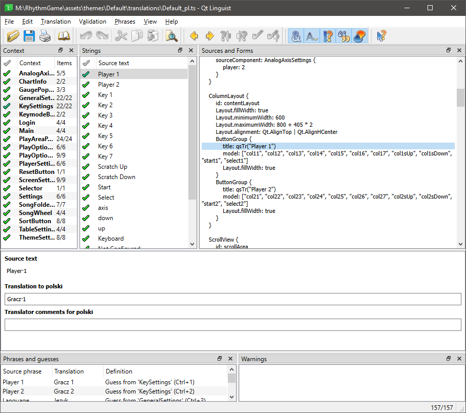

# Translating the game

Each theme declares its available languages and translation files in
`theme.json`. Settings labels are translated in JSON; QML text uses Qt
translation catalogs.

Default's catalog also contains shared text from Arena,
`RhythmGameQml/StandardSelectOptions.qml`, and C++ sources such as the Backbeat
integration. Those translations are available to all themes. Themes can use
the shared sorting and replay labels or supply their own text in their own
catalogs.

The [translation lesson](docs/pages/theme-tutorial/04-translations.md) includes
an installable example and commands for building its catalog.

## Theme settings strings

Settings files store translations directly in each setting's `name` and
`description` objects. Choice labels and group labels use the same format.
Add a language key beside the existing ones. See
[Default's k7 settings](https://github.com/Bobini1/RhythmGame/blob/master/share/RhythmGame/themes/Default/settings/k7.json)
for a complete file.

Locale identifiers use a supported subset of BCP 47: an ISO 639 language code,
an optional ISO 15924 script code, and an optional ISO 3166-1 territory code.
For example, `fr-CA` is Canadian French, `zh-Hans` is Simplified Chinese,
`zh-Hant-TW` is Traditional Chinese for Taiwan, and `zh-Hant-HK` is
Traditional Chinese for Hong Kong. Hyphens are preferred. Existing identifiers
with underscores, such as `fr_CA`, also work. Manifest keys are normalized at
load time.

Script subtags matter when a language uses more than one writing system. The
game first looks for an exact match, then the closest available entry in the
same language, preferring a matching script and territory. It avoids entries
for an incompatible script. If there is no match, it tries the system language
and then English. Settings labels use the first available entry as a final
fallback.

For example, here is a property with an added Canadian French translation:

```json
{
  "id": "verticalGauge",
  "name": {
    "en": "Vertical Gauge",
    "pl": "Pionowy wskaźnik",
    "fr-CA": "Jauge verticale"
  },
  "description": {
    "en": "Whether the life gauge is vertical (fills upwards).",
    "pl": "Pionowy wskaźnić życia (wypełnia się w górę).",
    "fr-CA": "Si la jauge de vie est verticale (se remplit vers le haut)."
  },
  "type": "boolean",
  "default": false
}
```

## Declare the available languages

Declare each supported language in the `translations` object in `theme.json`.
These keys make the language selectable in the game. Paths are relative to the
theme folder. For example:

```json
{
  "translations": {
    "en": "",
    "pl": "translations/Default_pl.qm",
    "fr-CA": "",
    "zh-Hans": "translations/Default_zh_Hans.qm",
    "zh-Hant-TW": "translations/Default_zh_Hant_TW.qm"
  }
}
```

A `.qm` file is a compiled Qt translation catalog. Use an empty path when that
language should display the original QML text. In the example, English uses
the source text and Canadian French translates only the settings labels.
An empty path does not try to load a catalog and is not an error.

If you supply a path, include that `.qm` file with the theme. A missing file is
logged and that language entry is skipped. Restart after changing the manifest
or replacing translation files. Once the files are loaded, changing the
profile's language updates the QML text and settings labels without restarting.

Each theme chooses its catalog using the language matching described above.
If there is no matching catalog or a string has no translation, Qt displays
the source text.

## Strings in QML files

To mark a string in a QML file as translatable, you need to wrap it in the `qsTr()` function.
An in-depth explanation of how to use it can be found in the
[Qt documentation](https://doc.qt.io/qt-6/i18n-source-translation.html#qml-use-qstr).

For translating strings in QML files, you will need to use the Qt Linguist toolchain.
There are three essential tools:

- `lupdate`: Extracts translatable strings and creates or updates a `.ts` file.
- `Linguist`: A GUI tool for translators to translate the strings in a `.ts` file.
- `lrelease`: Compiles a `.ts` file into a `.qm` file that can be used by the game.

Edit the `.ts` file in Qt Linguist, then compile it with `lrelease`. Keep the
source `.ts` file for future edits and ship the compiled `.qm` file with the
theme. Preserve placeholders such as `%1` and `%2` in translated text.

You can work on these files without building the game. Install the tools with
[Qt](https://www.qt.io/download-qt-installer-oss), then follow the commands in the
[translation lesson](docs/pages/theme-tutorial/04-translations.md).

Here is what it should look like inside Qt Linguist:



## Updating Default's translations

Default's `.ts` and `.qm` files live in
[`share/RhythmGame/themes/Default/translations/`](https://github.com/Bobini1/RhythmGame/tree/master/share/RhythmGame/themes/Default/translations).
With a configured developer build, use these targets:

```sh
cmake --build build/dev-rel --config Release --target update_translations
cmake --build build/dev-rel --config Release --target release_translations
```

Use your own build directory if it has a different name. `update_translations`
runs `lupdate` on the QML and C++ sources selected by the build. It updates the
catalog's source strings; translate those entries in Qt Linguist before running
`release_translations`. The latter compiles the catalogs and also runs during
normal game builds.

To add a language to Default, add its Qt locale code to
`I18N_TRANSLATED_LANGUAGES` in [CMakeLists.txt](https://github.com/Bobini1/RhythmGame/blob/master/CMakeLists.txt), reconfigure, and
run `update_translations`. After translating and compiling the new catalog,
add its language and `.qm` path to
[Default's manifest](https://github.com/Bobini1/RhythmGame/blob/master/share/RhythmGame/themes/Default/theme.json).
